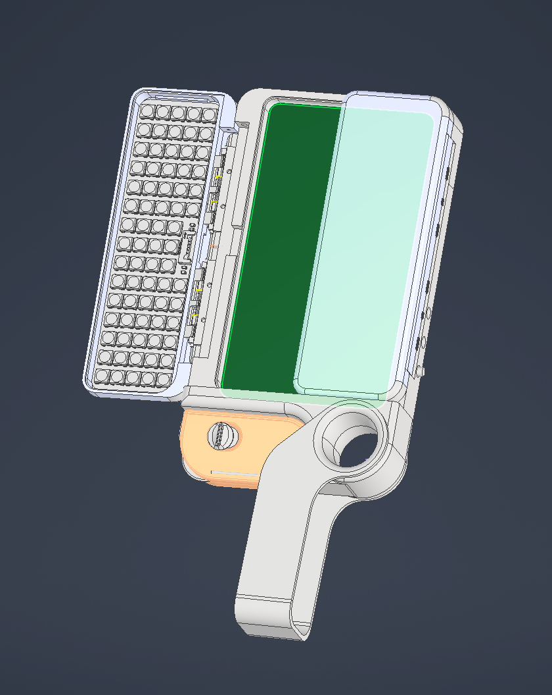

# Bright-有光团队（老灯团队）
## 前言:我为什么会去做这个产品?

    首先，我也会给女孩拍照，只不过真的会被骂了。。。。我确实觉得这个产品出现肯定会非常有意思，但是我的设计想法永远在价格上。。。我对所有的成本都控制的非常死。。可能我真的穷疯了。。。。

### 回归正题，让我来看看这产品图吧，其实我对越小的东西越感兴趣，只有做小，才会做到极致！
# 进度情况 0.1 版本这个版本是用来临时使用的
>-> 已完结 ->
# 产品模型以及基本内容
>+ 本产品会一直更新SETP格式文件，一般以总装配为标题
>+ 本次设计主要使用Inventor绘制,大多会转为step进行更新。
>+ step内容会单独设置文件夹 “STEP” 

## 技术报告（有啥说啥报告）
https://flowus.cn/share/86bad05a-7ee6-44d1-b82a-0c554120162c?code=58T0KF
【FlowUs 息流】有光“拍照神器”（但是我不知道是不是这么说）
访问密码myoq

## 完整装配图片 
